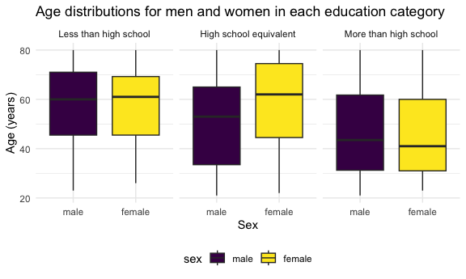
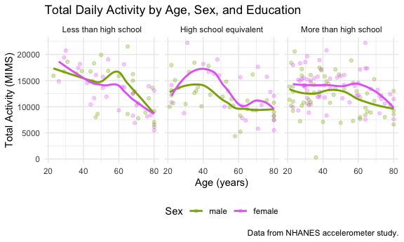
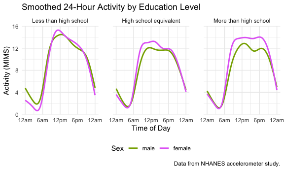
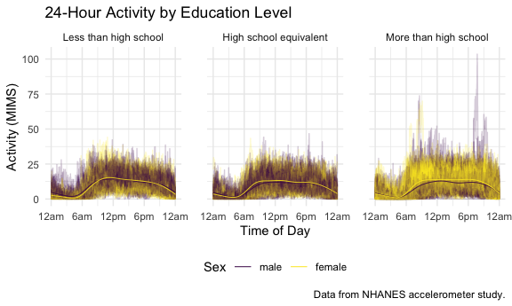

p8105_hw3_msj2167
================
2026-10-16

## Problem 2

Loading and cleaning the accelerometer dataset

``` r
nhanes_accel =
  read_csv(
    file = "data/nhanes_accel.csv",
    na = c("", "NA", ".")) |>
  janitor::clean_names() |>
   pivot_longer(
    min1:min1440, 
    names_to = "minute",
    names_prefix = "min",
    values_to = "mims") |>
      mutate (
      minute = as.numeric(minute))
```

    ## Rows: 250 Columns: 1441
    ## ── Column specification ────────────────────────────────────────────────────────
    ## Delimiter: ","
    ## dbl (1441): SEQN, min1, min2, min3, min4, min5, min6, min7, min8, min9, min1...
    ## 
    ## ℹ Use `spec()` to retrieve the full column specification for this data.
    ## ℹ Specify the column types or set `show_col_types = FALSE` to quiet this message.

``` r
nhanes_accel
```

    ## # A tibble: 360,000 × 3
    ##     seqn minute  mims
    ##    <dbl>  <dbl> <dbl>
    ##  1 62161      1 1.11 
    ##  2 62161      2 3.12 
    ##  3 62161      3 1.47 
    ##  4 62161      4 0.938
    ##  5 62161      5 1.60 
    ##  6 62161      6 0.145
    ##  7 62161      7 2.10 
    ##  8 62161      8 0.509
    ##  9 62161      9 1.63 
    ## 10 62161     10 1.20 
    ## # ℹ 359,990 more rows

Loading and cleaning the participants’ demographic data

``` r
nhanes_demo =
  read_csv(
    file = "data/nhanes_covar.csv",
    skip = 4, 
    na = c("", "NA", ".")) |>
  janitor::clean_names() |>
  mutate(
  sex = recode_values(
    sex,
    1 ~ "male",
    2 ~ "female"),
  sex = factor(sex, levels = c("male", "female")),
  education = recode_values(
    education, 
    1 ~ "Less than high school",
    2 ~ "High school equivalent",
    3 ~ "More than high school"),
    education = factor(education, levels = c(
      "Less than high school",
      "High school equivalent",
      "More than high school"))) |>
  filter (
    age >= 21) |>
    drop_na()
```

    ## Rows: 250 Columns: 5
    ## ── Column specification ────────────────────────────────────────────────────────
    ## Delimiter: ","
    ## dbl (5): SEQN, sex, age, BMI, education
    ## 
    ## ℹ Use `spec()` to retrieve the full column specification for this data.
    ## ℹ Specify the column types or set `show_col_types = FALSE` to quiet this message.

``` r
nhanes_demo
```

    ## # A tibble: 228 × 5
    ##     seqn sex      age   bmi education             
    ##    <dbl> <fct>  <dbl> <dbl> <fct>                 
    ##  1 62161 male      22  23.3 High school equivalent
    ##  2 62164 female    44  23.2 More than high school 
    ##  3 62169 male      21  20.1 High school equivalent
    ##  4 62174 male      80  33.9 More than high school 
    ##  5 62177 male      51  20.1 High school equivalent
    ##  6 62178 male      80  28.5 High school equivalent
    ##  7 62180 male      35  27.9 More than high school 
    ##  8 62184 male      26  22.1 High school equivalent
    ##  9 62189 female    30  22.4 More than high school 
    ## 10 62199 male      57  28   More than high school 
    ## # ℹ 218 more rows

Merging the datasets

``` r
nhanes_combined_df = 
  left_join(nhanes_demo, nhanes_accel, by = "seqn")

nhanes_combined_df
```

    ## # A tibble: 328,320 × 7
    ##     seqn sex     age   bmi education              minute  mims
    ##    <dbl> <fct> <dbl> <dbl> <fct>                   <dbl> <dbl>
    ##  1 62161 male     22  23.3 High school equivalent      1 1.11 
    ##  2 62161 male     22  23.3 High school equivalent      2 3.12 
    ##  3 62161 male     22  23.3 High school equivalent      3 1.47 
    ##  4 62161 male     22  23.3 High school equivalent      4 0.938
    ##  5 62161 male     22  23.3 High school equivalent      5 1.60 
    ##  6 62161 male     22  23.3 High school equivalent      6 0.145
    ##  7 62161 male     22  23.3 High school equivalent      7 2.10 
    ##  8 62161 male     22  23.3 High school equivalent      8 0.509
    ##  9 62161 male     22  23.3 High school equivalent      9 1.63 
    ## 10 62161 male     22  23.3 High school equivalent     10 1.20 
    ## # ℹ 328,310 more rows

Making a table for the number of men and women in each education
category

``` r
nhanes_demo |>
  group_by(education) |>
  summarize(
    male = sum(sex == "male"),
    female = sum(sex == "female"),
    total = n()) |>
   knitr::kable(col.names = c("Education", "Men", "Women", "Total"))
```

| Education              | Men | Women | Total |
|:-----------------------|----:|------:|------:|
| Less than high school  |  27 |    28 |    55 |
| High school equivalent |  35 |    23 |    58 |
| More than high school  |  56 |    59 |   115 |

Visualizing the age distributions for men and women in each education
category

``` r
nhanes_demo |>
  ggplot(aes(x = sex, y = age, fill = sex)) +
  geom_boxplot() +
  facet_grid(. ~ education)
```



Description of the data:

About half of participants (115 of 228) completed more than high school,
while roughly one quarter completed less than high school (55) and one
quarter completed a high school equivalent (58). Men and women are
evenly distributed across education categories, except for the high
school equivalent category, which includes more men than women (35
vs. 23). Age also varies by education level. Participants with less than
a high school education are the oldest, with similar median ages for men
and women (about 60). In the high school equivalent group, women are
older than men (median about 62 vs. 53). Participants with more than a
high school education are the youngest, with median ages around 41–43
for both sexes. Overall, median age decreases as education level
increases

Creating a total activity variable for each participant

``` r
nhanes_summed_mims =
  nhanes_combined_df |>
  group_by(seqn, sex, age, education) |>
  summarize(total_activity = sum(mims), .groups = "drop")

nhanes_summed_mims
```

    ## # A tibble: 228 × 5
    ##     seqn sex      age education              total_activity
    ##    <dbl> <fct>  <dbl> <fct>                           <dbl>
    ##  1 62161 male      22 High school equivalent         13194.
    ##  2 62164 female    44 More than high school          13411.
    ##  3 62169 male      21 High school equivalent          9991.
    ##  4 62174 male      80 More than high school           8579.
    ##  5 62177 male      51 High school equivalent         11918.
    ##  6 62178 male      80 High school equivalent          7489.
    ##  7 62180 male      35 More than high school          14205.
    ##  8 62184 male      26 High school equivalent         13599.
    ##  9 62189 female    30 More than high school          18551.
    ## 10 62199 male      57 More than high school          14548.
    ## # ℹ 218 more rows

``` r
nhanes_summed_mims |>
  ggplot(aes(x = age, y = total_activity, color = sex)) +
  geom_point(alpha = .3) +
  geom_smooth(se = FALSE) +
  facet_grid(. ~ education) +
  scale_colour_hue(h = c(100, 300)) +
  labs(
    title = "Total Daily Activity by Age, Sex, and Education",
    x = "Age (years)",
    y = "Total Activity (MIMS)",
    color = "Sex",
    caption = "Data from NHANES accelerometer study.")
```

    ## `geom_smooth()` using method = 'loess' and formula = 'y ~ x'


Plot Description:

Total daily activity generally declines with age, though the pattern
differs by sex and education level. Among participants with less than a
high school education, activity declines most steeply, from about 18,500
MIMS for women and 17,000 MIMS for men in their 20s to about 9,000 MIMS
for both sexes by age 80. Women in this group are more active than men
until about age 40, after which men are more active, rising from age 50
to a peak at 60 before declining again. In the high school equivalent
group, women are more active than men through most of adulthood;
activity rises for both sexes to a peak around age 40, then declines
steadily, with a smaller second peak for women around age 70. Among
participants with more than a high school education, activity is the
most stable, remaining fairly level until about age 45 for men and age
60 for women before declining, and women are more active than men at
nearly all ages.

``` r
nhanes_combined_df |>
  ggplot(aes(x = minute, y = mims, color = sex)) +
  geom_smooth(se = FALSE) +
  facet_grid(. ~ education) +
  scale_x_continuous(
    breaks = c(0, 360, 720, 1080, 1440),
    labels = c("12am", "6am", "12pm", "6pm", "12am")) +
  scale_colour_hue(h = c(100, 300)) +
  labs(
    title = "Smoothed 24-Hour Activity by Education Level",
    x = "Time of Day",
    y = "Activity (MIMS)",
    color = "Sex",
    caption = "Data from NHANES accelerometer study.") +
  theme(panel.spacing = unit(1.5, "lines"))
```

    ## `geom_smooth()` using method = 'gam' and formula = 'y ~ s(x, bs = "cs")'



``` r
nhanes_combined_df |>
  ggplot(aes(x = minute, y = mims, color = sex)) +
  geom_line(aes(group = seqn), alpha = 0.2) +
  geom_smooth(se = FALSE, linewidth = 0.3) +
  facet_grid(. ~ education) +
  scale_x_continuous(
    breaks = c(0, 360, 720, 1080, 1440),
    labels = c("12am", "6am", "12pm", "6pm", "12am")) +
  labs(
    title = "24-Hour Activity by Education Level",
    x = "Time of Day",
    y = "Activity (MIMS)",
    color = "Sex",
    caption = "Data from NHANES accelerometer study.") +
  theme(
    legend.position = "bottom",
    panel.spacing = unit(1.5, "lines"))
```

    ## `geom_smooth()` using method = 'gam' and formula = 'y ~ s(x, bs = "cs")'


A.I Disclosure: used AI to figure out how to get my labels to stop
overlapping (line X).

Plot Description:

The timing of daily activity is similar across education levels and
sexes, with only slight differences in activity level. It is lowest
between about 3am and 5am, rises sharply between 6am and 10am, stays
elevated through the afternoon, and declines in the evening around 7pm.
Within each education level, the timing of daily activity for men and
women are close. Women are slightly more active than men during the day
in the high school equivalent and more than high school education
groups, with the clearest difference in the more than high school group.
In the less than high school group, men and women have similar daytime
activity, but men are slightly more active around midnight and in the
early morning. The more than high school group shows the most variation
between individuals, with some participants reaching much higher
activity levels.

## Problem 3
